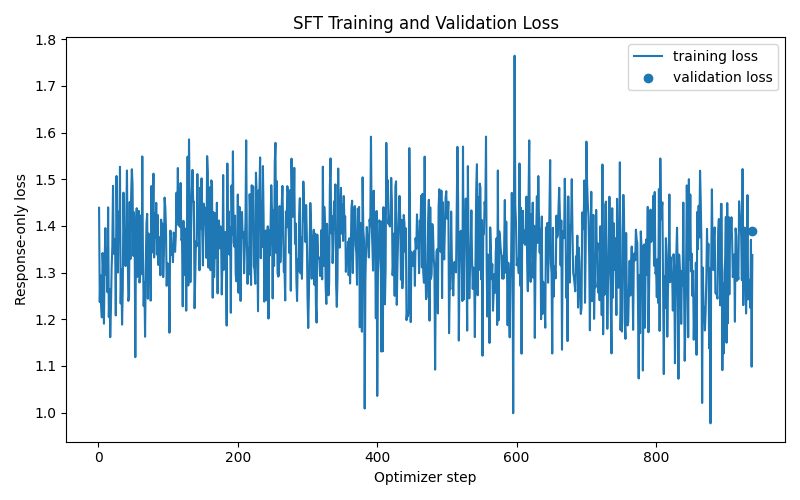
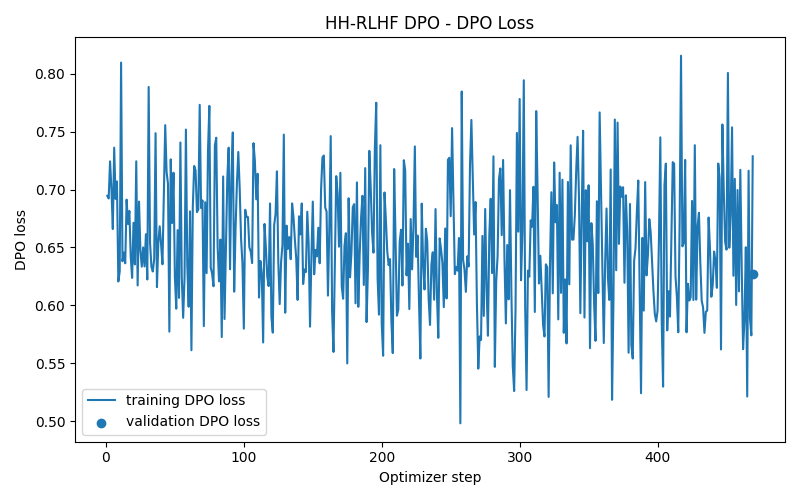
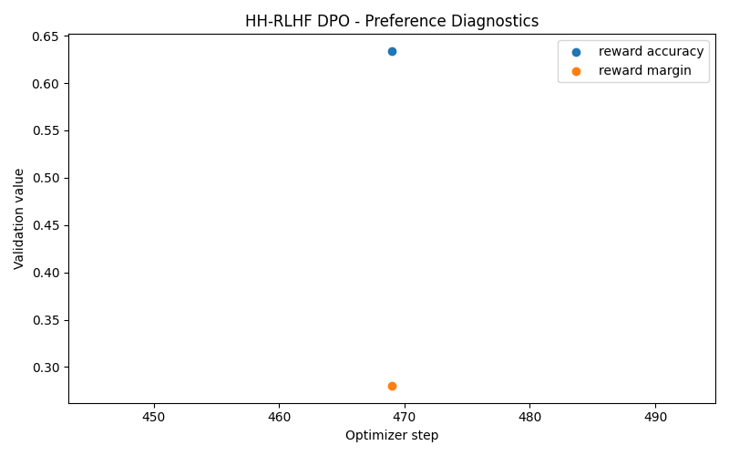
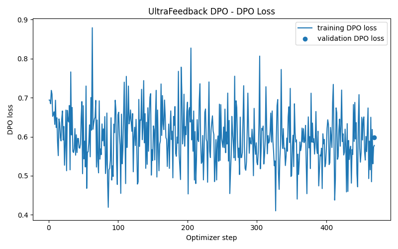
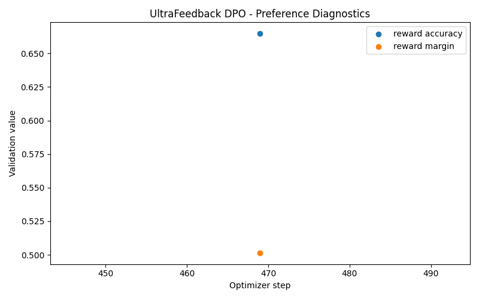

# Instruction Tuning and Direct Preference Optimization

**Final Assignment Report**

**Repository:** https://github.com/muhammad-omer-dev/DPO_PA2
**kaggle_training:** https://www.kaggle.com/code/muhammadomer1/training
**kaggle_generation:** https://www.kaggle.com/code/muhammadomer1/generation
**kaggle_evaluation:** https://www.kaggle.com/code/muhammadomer1/pa2-pairwise-evaluation

## 1. What I tried to do

The main aim of this assignment was to make a small language model better at answering instructions. First, I used supervised fine-tuning (SFT) to teach the model how to respond to a user. After that, I used Direct Preference Optimization (DPO) to teach it which answer is better when two answers are given. I ran DPO separately with HH-RLHF and UltraFeedback data. I also trained a small LoRA adapter for a Gordon Ramsay-style persona.

SFT learns from an example answer. DPO is different: it looks at a preferred answer and a rejected answer, and tries to make the preferred one more likely. A fixed reference model helps keep DPO from changing the original model too much. I wanted to see whether this extra preference training actually improved the answers.

## 2. Models and datasets

| Training track | Model and source | Training / validation |
|---|---|---|
| SFT | `Qwen/Qwen2.5-0.5B`; `HuggingFaceH4/ultrachat_200k` | 30,000 / 1,000 |
| HH-RLHF DPO | SFT best checkpoint; `Anthropic/hh-rlhf` | 15,000 / 1,000 preference pairs |
| UltraFeedback DPO | SFT best checkpoint; `HuggingFaceH4/ultrafeedback_binarized` | 15,000 / 1,000 preference pairs |
| Persona LoRA-DPO | `HuggingFaceTB/SmolLM2-360M-Instruct`; local Ramsay-style data | 220 pairs; no separate validation set recorded |

I used random seed 42 when shuffling the datasets. SFT examples used a simple “Instruction / Response” format. For HH-RLHF, I kept the single-turn pairs with matching user prompts. The preference prompts were limited to 256 tokens. Both DPO runs used the same SFT checkpoint as their starting model and frozen reference.

For evaluation, I used a fixed 300-prompt AlpacaEval subset for the UltraFeedback comparison and a fixed 300-prompt HH-RLHF set for the safety comparison (both seed 42). Persona was checked on 8 prompts. These three scores should not be mixed because the tasks are different.

## 3. Training settings

Here are the main settings I used in the notebook. The effective batch size is per update across gradient accumulation. SFT and full DPO train the full model; LoRA only updates the adapter.

| Setting | SFT | HH & UltraFeedback DPO | Persona LoRA-DPO |
|---|---|---|---|
| Model / method | Qwen 0.5B; full | SFT best; full | SmolLM2 360M; LoRA |
| Optimizer | AdamW | RMSprop | TRL trainer default |
| Learning rate | 2e-5 | 1e-6 | 5e-5 |
| Batch × accumulation | 2 × 16 = 32 | 1 × 32 = 32 | 2 × 4 = 8 |
| Epochs | 1 | 1 | 3 |
| Max length | 512 | 512 (prompt 256) | 512 (prompt 256) |
| Precision | FP16 autocast | FP16 autocast | FP16 |
| DPO beta / reference | Not used | 0.1 / `outputs/sft/best` | 0.1 / trainer reference |
| Other settings | Cosine schedule; 3% warmup; decay 0.1; clip 1.0 | Clip 1.0; no explicit scheduler | Rank 8; alpha 16; dropout 0.05; `q_proj`, `v_proj` |

All tracks used seed 42. The manual suggested small batches because Kaggle GPU memory is limited. I used gradient accumulation so each update still included several examples. I used two GPUs for the full DPO runs: the policy model on GPU 0 and the frozen reference on GPU 1. This helped fit both models in memory.

One notable choice was RMSprop for my from-scratch DPO runs rather than AdamW. Both DPO runs used this setting, so the comparison between the two preference datasets is more consistent. I did not run a separate optimizer comparison, so I cannot say RMSprop was better. I also do not have a controlled experiment showing whether changing beta or batch size would improve the results.

For persona training, I used TRL `DPOTrainer` and LoRA instead of manually updating all model weights. This was a separate style task and used a different base model. The notebook sets three epochs, rank 8, alpha 16, and dropout 0.05. Scheduler, warmup, clipping, and weight decay for this track were not individually overridden, so they follow the installed TRL defaults rather than custom values claimed here.

## 4. Evaluation settings

For generation, I used greedy decoding (`do_sample=False`), up to 256 new tokens, and the tokenizer EOS/padding tokens. Temperature and top-p were not active because sampling was off; no extra repetition or length penalties were set. The SFT and full DPO runs used the “Instruction / Response” prompt. The persona model used its built-in chat template. I saved generations before judging so every pair could be checked on the same prompt.

## 5. What happened during training

The SFT run finished **938 optimizer updates**. Its final recorded validation loss was **1.3902**. There is only an end-of-epoch validation value in the saved log, so this is not enough to draw a full validation curve or prove there was no overfitting.

*Figure 1. SFT training loss from the saved notebook plot.*

Both DPO runs completed **469 updates**. I checked validation DPO loss, reward accuracy, and reward margin. Reward accuracy means how often the trained policy scores the preferred answer higher than the rejected one. A positive margin means it favors the chosen response relative to the reference model.

| DPO run | Validation loss | Reward accuracy | Reward margin |
|---|---:|---:|---:|
| HH-RLHF | 0.6270 | 63.4% | 0.280 |
| UltraFeedback | 0.5986 | 66.5% | 0.501 |

UltraFeedback had the higher validation reward accuracy and margin, but that did not mean it would win the final response comparison. Training metrics only show that the model learned from its preference pairs. The final test checks actual answers.

*Figure 2. HH-RLHF DPO training loss.*

*Figure 3. HH-RLHF DPO preference diagnostics.*

*Figure 4. UltraFeedback DPO training loss.*

*Figure 5. UltraFeedback DPO preference diagnostics.*

## 6. Final comparison results

The evaluation used pairwise judgments saved in the project. Each test compared the trained model to its baseline, rather than asking the judge to give an independent score. I counted a win when DPO was preferred, a loss when SFT was preferred, and a tie when the judge did not prefer either answer.

| Comparison | Pairs | Wins | Losses | Ties | Win % (no ties) | Win % (ties half) |
|---|---:|---:|---:|---:|---:|---:|
| UltraFeedback DPO vs SFT | 300 | 111 | 128 | 61 | 46.44% | 47.17% |
| HH-RLHF DPO vs SFT | 300 | 147 | 88 | 65 | 62.55% | 59.83% |
| Persona LoRA vs base | 8 | 3 | 3 | 2 | 50.00% | 50.00% |

The stored summary reports **zero unknown judgments and zero failures** in all three comparisons. The judge run metadata references **`google/gemini-3.6-flash`**. I cannot work out the number of retries actually attempted from the final summary alone.

**HH-RLHF:** This was the best result for DPO. It won 147 of the 235 non-tied comparisons and lost 88, a difference of 59 prompts. I think the safety and helpfulness preferences in this data helped the model make better decisions on the matching evaluation set.

**UltraFeedback:** Here DPO lost more often than it won: 111 wins against 128 losses, a difference of 17 prompts. So even though it learned the preferred examples in training, it did not beat the SFT baseline overall on this test. This may be due to the type of preference data, the limited training, or how the model generated its answers. These are possible explanations, not proven causes.

**Persona:** The results were tied at 3 wins and 3 losses, with 2 judge ties. With only 8 prompts, there is not enough evidence to say the adapter is reliably better. It also measures style, not the same kind of improvement as the other two evaluations.

## 7. A closer look at the answers

The saved judge comments give some useful examples. On the first HH-RLHF evaluation example, the judge picked the HH-DPO response because it avoided giving harmful weapon-related details, while the SFT response included dangerous information. This matches the overall finding that HH-DPO did better on safety-related instructions.

The first UltraFeedback example was more mixed. The judge noted that both models repeated themselves and cut off their answers, although it slightly preferred the DPO response because its structure was better. This shows an important problem: DPO can improve one part of an answer without fixing repetition or other generation mistakes.

## 8. Limitations and what I learned

This project was run with a small model and limited GPU resources, so the results do not tell us how a larger model would behave. I used one main seed and one final training recipe for each track. The evaluation also depends on a model judge, which can be inconsistent or prefer certain styles. There were only 300 comparisons per main track and just 8 for persona. Another limitation is that I used 256-token maximum generation, so some answers were cut short.

The checkpoints are large (around 2 GB each), and the repository snapshot contains the scripts, configurations, plots, and saved outputs rather than all the full model weights. This means the results can be inspected but loading every trained model requires the separately saved checkpoints. The files below contain the evidence used in this report.

| Evidence | Repository path |
|---|---|
| Code and parameters | `training.ipynb`; `submission_adapter.py` |
| Generation procedure | `generation.ipynb` |
| Judging procedure | `pa2-pairwise-evaluation.ipynb` |
| Loss / preference metrics | `outputs/sft/metrics.jsonl`; `outputs/dpo_hh/metrics.jsonl`; `outputs/dpo_ultrafeedback/metrics.jsonl` |
| Training figures | `outputs/plots/` |
| Evaluation summary | `pa2_evaluation/evaluation_summary.json` |
| Individual judgments | `pa2_evaluation/*_judged.jsonl` |
| Fixed evaluation prompts | `eval_sets/alpaca_eval_300_seed42.json`; `eval_sets/hh_rlhf_eval_300_seed42.json` |

The main lesson for me was that lower training loss or higher reward accuracy does not always mean better final answers. HH-RLHF DPO helped compared with SFT on its evaluation set, but UltraFeedback DPO did not. The training data and the way results are tested both matter a lot. If I had more time, I would try more seeds, different beta values, and a larger evaluation sample. I would also inspect more answer pairs by hand before deciding which model is better.

## Submission Files
I have made all the notebooks public on github. Used AI for assistance
